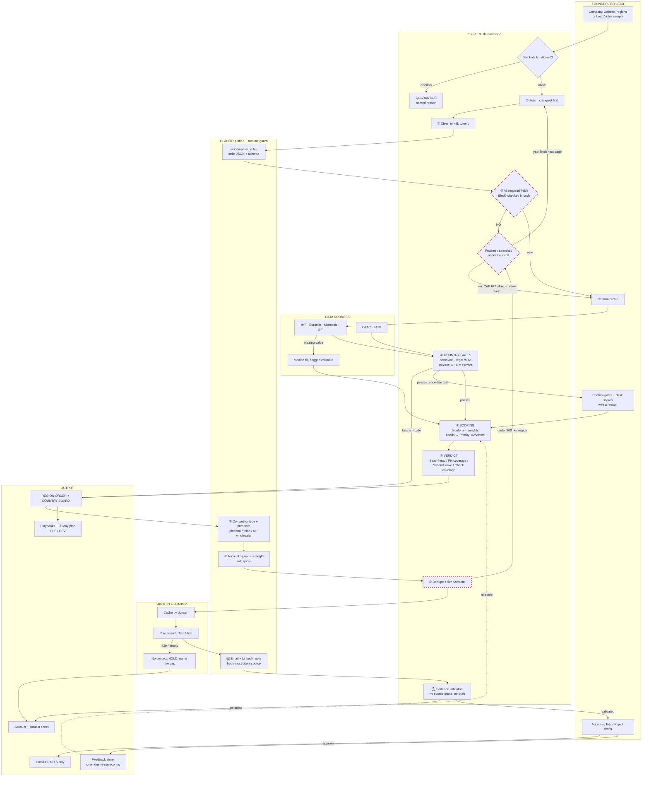

# Components Map: AI GTM Expansion Tool

> Format taken from the Sprinto case (`G3_Components_Map.md`): swimlanes by **Actor**, columns **Trigger · Input · Context · Processing · AI · Output**. Every box carries a failure mode and a fallback.
> Design rule carried over from Sprinto: **rules decide, AI explains.** Code applies gates, scores and verdicts. The model reads messy text and drafts; it never decides a verdict.
> First test case: Vobiz.ai. Modules M1–M8 are from the build brief.

---

## 1. The map, in swimlane format

| Actor | Trigger | Input | Context | Processing | AI | Output |
|---|---|---|---|---|---|---|
| **Founder / BD lead** *(user)* | Enters company name, website, target regions; or clicks **Load Vobiz sample** | Company, regions, free-text context, constraints, optional coverage data | Their own rubric: weights, band cut-offs, gate rules, all editable | **Confirms** the enriched profile (A); **confirms or overrides** each gate call and each desk score with a reason (B); **Approve / Edit / Reject** each draft (C) | none | Final plan they can defend: region order, country verdicts, accounts, contacts, drafts |
| **System** *(the app)* | A run starts, one region at a time | Cleaned company text, public indicator tables, search results | The rubric, plus the list of required fields per module | **① robots.txt gate → ② fetch → ③ clean → ⑤ field-completeness check (in code) → ⑥ country gates → ⑦ scoring and verdict → ⑩ account dedupe and tiering → ⑪ evidence validator** | none | Verdict, score and the rule that fired, every figure with its source URL, quarantine rows with named reasons, cost ledger |
| **Data sources** *(IMF, Eurostat, Microsoft AI Diffusion, EF EPI, OFAC, FATF)* | Called when a country enters scoring | Country list for the region | Indicator IDs and edition/year to use | Cache by indicator, year and country, then live call, then **median fill flagged "estimate"** | none | Raw indicator values with URL, edition and fetch date |
| **Search and crawler** *(web search API, page fetch)* | Competitor mapping (M4) and account discovery (M5) | Queries built from region × industry × signal type | Allow-list of page types (customers, case studies, press, careers) | Cache, fetch cheapest method first, respect robots.txt, **hard cap per region** | none | Candidate pages and snippets with URLs |
| **AI model** *(Claude)* | Called at five points only | Cleaned page text, never raw HTML | The named fields it must fill, nothing else | Strict JSON out, schema-validated, 1 retry on invalid | **④ company profile → ⑧ competitor type and presence → ⑨ account signal and strength → ⑫ email and LinkedIn draft** | Populated fields, each with a verbatim quote or "not stated"; a draft whose hook carries a source |
| **Apollo and Hunter** *(find contacts)* | Called only for Tier 1 and Strong-signal accounts | Account domain | Role filter: owner of calling or voice-agent stack, plus buying-committee roles | Cache lookup, then live call, then quota meter | none | Name, title, email with verification status, phone, LinkedIn URL, source, date |
| **Gmail** *(drafts only)* | The user clicks **Save to Gmail drafts** | The approved draft | Draft endpoint only; **no send scope is requested** | `users.drafts.create` | none | Draft in the user's Gmail, or status `draft_failed` with the reason in red |

**Flow legend:** main flow step by step. **Conditional flow** = the discovery loop, repeating only while required fields are missing or the account count is under target. Handoff to output = the final plan.

---

## 2. The map as a diagram

**The dashed pink path is the discovery loop.** It runs while a required field is empty (company profile) or a region is under its account target. It has a hard cap, so cost has a ceiling.

---

## 3. Every box: failure mode and fallback

| # | Box | Failure mode | Fallback | Visible to the user as |
|---|---|---|---|---|
| ① | robots.txt gate | File unreachable, or page disallowed | **Treat as disallow** | Quarantine row: `robots_unreachable` |
| ② | Fetch | JS shell, 404, bot block | Reader fetch, then **stop**; never fight bot detection | Per-page "fetched via: plain / reader / failed" |
| ③ | Clean | Over-cleans, leaves too little text | Counted as thin signal, which triggers the loop | `thin_content` flag |
| ④ | Company profile | Invalid JSON, 429, invented facts | 1 retry with the error, then rules-only (keyword extraction). Every field carries a quote or "not stated" | Orange "rules-only" badge; quote under each field |
| ⑤ | Field check | *none: this is code, it cannot hallucinate* | none | "What's still missing" list |
| loop | Loop controller | Runs forever, or cost explodes | **Hard cap** on fetches and searches per region and a **per-run cost ceiling**, set before the build | Loop trace: each fetch, why chosen, what it filled |
| ⑥ | Country gates | Rule too loose or too strict (check 3: Russia, Belarus and Yemen slipped past the old wording) | Gate rules written as testable lines. "Legal route" and "no payment route" are **human calls with a stored reason** | Rule ID that fired, e.g. `G-02: on FATF call-for-action list` |
| ⑦ | Scoring | A source is missing for a country (UK and Singapore had holes) | **Median of countries that have data, flagged "estimate"**. Same input gives the same score, asserted by a test | Orange "estimated" tag and source URL on every cell |
| ⑦ | Desk scores | Judgement hidden inside a number (check 2: competition, B2B rules, partner outside Europe) | Entered by a human with a **required reason**, shown as "analyst judgement", never mixed with sourced data | Separate column, reason on hover |
| ⑦ | Verdict | Readiness unknown | Falls to **Check coverage**, never to Beachhead | Verdict plus the rule that fired |
| ⑧ | Competitor type | Telco mixed with platform | Fixed 4-type list; unsure goes to "unclassified", not a guess. Presence tick requires the competitor's own page | Source page link on every tick |
| ⑨ | Account signal | Invented signal | Must carry a verbatim quote and URL, or the words "not stated". Strength = Strong / Medium / Low / **Gap** | Quote and URL on the account row |
| ⑩ | Dedupe and tier | Duplicates, dead links, junk | Dedupe by domain; dead URLs go to quarantine; Tier 1 limited to Strong signals | Duplicate and dead-link counters |
| ⑩ | Account target | Cannot reach 300 valid accounts | **Stop at the cap and report the real number**; never pad the list | "212 of 300, 3 searches left" banner |
| ⑪ | Evidence validator | *none: code* | **A hook with no source quote cannot become a draft** | "Held: hook has no source" |
| — | Apollo / Hunter | 429 quota, empty, stale | Cache, then **HOLD: contact unavailable** with the gap named. Verification status stored per email | Quota meter; "source: live / cached" on every contact |
| ⑫ | Draft | Generic, wrong tone, false claim | Hook must name an account-specific fact; opt-out line always present; tone set per region; LinkedIn note under 300 characters, checked in code | Hook's source one click away |
| — | Gmail | Token expired, API error | **Fail loudly.** Draft persists in the app, status `draft_failed` with reason | Red banner on the card |
| — | LinkedIn | Tempting to scrape | **Not built.** URLs come only from Apollo; notes are sent by hand | A visible "manual step" label |
| — | Feedback | Goes nowhere | Overrides and rejections are stored and **re-run scoring** | "What changed because of your feedback" panel |

---

## 4. Where the human sits

| Step | Human action | Why |
|---|---|---|
| A. After ④ | Confirm or edit the company profile | The brief says to show the context before running |
| B. At ⑥ and ⑦ | Confirm legal-route and payment calls; enter desk scores with a reason | These are judgement, not data (checks 2 and 3) |
| C. At ⑫ | Approve, edit or reject each draft | Nothing sends automatically; the tool only creates Gmail drafts |

## 5. Mapping to the brief's modules

| Module | Boxes |
|---|---|
| M1 Company understanding | ①–⑤ |
| M2 Country gates | ⑥ |
| M3 Market scoring | ⑦ |
| M4 Competitors | ⑧ |
| M5 Account discovery | ⑨, ⑩, loop |
| M6 Contacts | Apollo / Hunter |
| M7 Outreach drafts | ⑫, ⑪ |
| M8 Strategy output | Output lane (region order, playbooks, 90-day plan, exports) |
